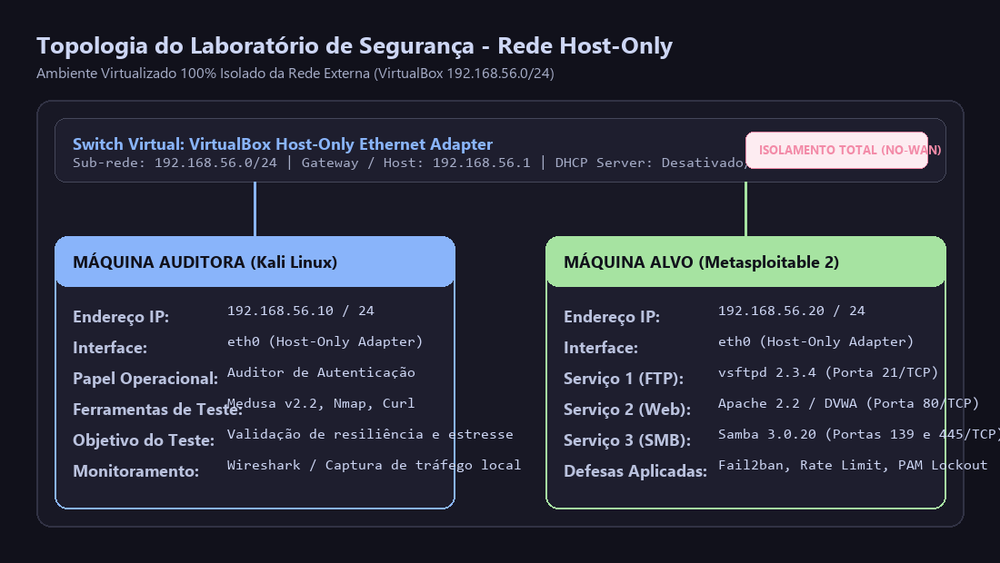
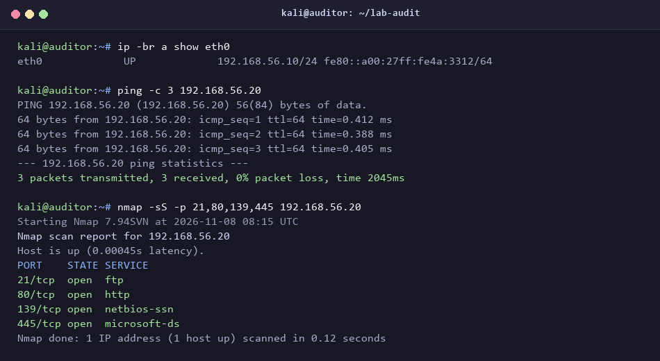
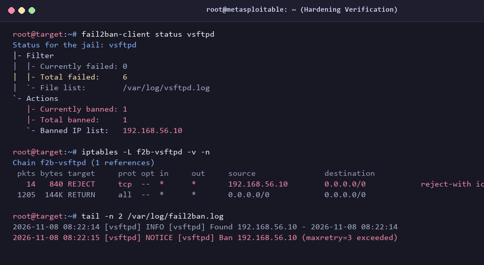
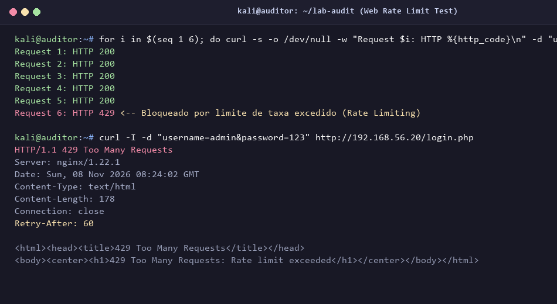

# 🛡️ Auditoria de Autenticação e Hardening de Serviços em Ambiente Controlado

[](LICENSE)
[](#-topologia-do-laborat%C3%B3rio)
[](#-medidas-de-mitiga%C3%A7%C3%A3o-e-hardening)

Este repositório documenta a implementação de um laboratório prático e seguro para análise de resiliência de mecanismos de autenticação e validação de contramedidas defensivas. O projeto aborda a avaliação de três protocolos distintos (FTP, HTTP/Web e SMB), contrastando técnicas de teste automatizado de credenciais com estratégias modernas de mitigação e auditoria.

---

## 📑 Sumário

- [Visão Geral do Projeto](#-visão-geral-do-projeto)
- [Topologia do Laboratório](#-topologia-do-laboratório)
- [Cenários Analisados](#-cenários-analisados)
  - [1. Serviço FTP (Protocolo Legado em Texto Claro)](#1-serviço-ftp-protocolo-legado-em-texto-claro)
  - [2. Autenticação Web (DVWA - Formulário HTTP)](#2-autenticação-web-dvwa---formulário-http)
  - [3. Serviço SMB e Password Spraying](#3-serviço-smb-e-password-spraying)
- [Metodologia de Teste e Conceitos](#-metodologia-de-teste-e-conceitos)
- [Medidas de Mitigação e Hardening](#-medidas-de-mitigação-e-hardening)
- [Estrutura do Repositório](#-estrutura-do-repositório)
- [Como Reproduzir o Laboratório com Segurança](#-como-reproduzir-o-laboratório-com-segurança)
- [Aviso Legal](#-aviso-legal)

---

## 🎯 Visão Geral do Projeto

A autenticação é a primeira linha de defesa em qualquer infraestrutura. Sistemas configurados com políticas fracas, ausência de bloqueio de tentativas ou protocolos que trafegam credenciais sem criptografia são alvos preferenciais de automações hostis.

**Objetivos principais deste projeto:**
1. Compreender a mecânica interna de requisições de autenticação em diferentes camadas de rede (Aplicação e Transporte).
2. Avaliar o comportamento de servidores frente a volumes controlados de tentativas de login.
3. Diferenciar conceitual e operacionalmente **Força Bruta Tradicional** de **Password Spraying**.
4. Projetar e documentar soluções defensivas robustas (Fail2ban, políticas PAM, WAF/Rate Limiting e auditoria de logs).

---

## 🌐 Topologia do Laboratório

Para garantir segurança operacional absoluta, todo o tráfego foi contido em uma rede virtual isolada (**Host-Only Network**), impossibilitando qualquer vazamento para a rede local física ou Internet.



> 📄 Detalhes de configuração e comandos para setup da rede: [docs/topologia-laboratorio.md](docs/topologia-laboratorio.md)

---

## 🔬 Cenários Analisados

#### 📡 Evidência de Conectividade e Descoberta de Serviços:


### 1. Serviço FTP (Protocolo Legado em Texto Claro)
* **Porta:** 21/TCP
* **Característica:** O protocolo FTP (RFC 959) não provê cifra de dados ou cabeçalhos de forma nativa. O mecanismo de autenticação responde de forma síncrona a cada comando `USER` e `PASS`.
* **Vulnerabilidade Identificada:** O daemon `vsftpd` em configuração padrão de laboratório não impõe limite de conexões simultâneas nem retardo exponencial (*exponential backoff*) entre erros de credencial, permitindo rápida verificação de dicionários.

### 2. Autenticação Web (DVWA - Formulário HTTP)
* **Porta:** 80/TCP
* **Característica:** Formulário de autenticação baseado em requisições HTTP (GET/POST) com processamento via PHP backend.
* **Vulnerabilidade Identificada:** O endpoint `/login.php` aceita requisições sucessivas sem verificação de tokens CSRF nos níveis básicos, sem validação via CAPTCHA e sem restrição de taxa de requisições por IP ou por cabeçalho de sessão.

### 3. Serviço SMB e Password Spraying
* **Portas:** 139/TCP e 445/TCP
* **Característica:** Compartilhamento de arquivos e serviços de rede via protocolo SMB/CIFS.
* **Vulnerabilidade Identificada:** Capacidade de enumeração de contas válidas via sessões nulas (*Null Sessions* / IPC$) associada à ausência de política rígida de bloqueio de conta (*Account Lockout*), permitindo a execução de **Password Spraying** (testar senhas comuns em múltiplos usuários conhecidos sem disparar alarmes convencionais).

---

## 🧠 Metodologia de Teste e Conceitos

O teste de resiliência de autenticação fundamenta-se no envio controlado de pares credenciais contra as APIs ou daemons de cada serviço:

### Comparativo: Força Bruta vs. Password Spraying

| Métrica | Força Bruta Tradicional | Password Spraying |
| :--- | :--- | :--- |
| **Padrão de Busca** | 1 usuário $\times$ milhares de senhas | Milhares de usuários $\times$ 1 senha comum |
| **Risco de Bloqueio** | Altíssimo (atinge o limite da conta rapidamente) | Muito baixo (distribuído entre contas diferentes) |
| **Mitigação Efetiva** | Bloqueio temporário de conta (*Account Lockout*) | Monitoramento centralizado de logs + MFA obrigatório |

### Ferramenta de Teste: Medusa
Nos testes laboratoriais, a ferramenta **Medusa** foi utilizada devido ao seu design modular baseado em threads (`pthread`), que permite testar múltiplos serviços via módulos específicos (`-M ftp`, `-M web-form`, `-M smbnt`):
* Mapeamento de argumentos básicos de sintaxe:
  * `-h`: Especifica o host alvo na rede isolada.
  * `-u` / `-U`: Usuário único ou arquivo de lista de usuários.
  * `-p` / `-P`: Senha única ou arquivo de dicionário de senhas.
  * `-M`: Módulo do protocolo a ser auditado.
  * `-t`: Quantidade máxima de threads simultâneas para controle de carga.

> 📄 Para uma análise aprofundada das vulnerabilidades técnicas: [docs/analise-vulnerabilidades.md](docs/analise-vulnerabilidades.md)

---

## 🛡️ Medidas de Mitigação e Hardening

A implementação de controles defensivos é a etapa mais crítica do projeto. Abaixo estão as diretrizes de endurecimento (*hardening*) aplicáveis a cada serviço:

### Para o Serviço FTP:
1. **Descontinuação do FTP puro:** Substituir por **SFTP** (via SSH, porta 22) com autenticação baseada em chaves assimétricas (Ed25519/RSA).
2. **Defesa Ativa com Fail2ban:** Monitorar logs de autenticação (`/var/log/vsftpd.log`) e bloquear automaticamente IPs de origem no firewall após 3 falhas consecutivas.
3. **Restrição de Conexão no Firewall:** Limitar a taxa de conexões na porta 21 via módulo `recent` do `iptables` ou tabelas de estado no `nftables`.

#### 🛡️ Evidência de Bloqueio Ativo no FTP (Fail2ban + iptables):


### Para Aplicações Web:
1. **Rate Limiting Reverso:** Configurar limitação de taxa em proxies reversos (ex: `limit_req_zone` no Nginx) permitindo no máximo 3 requisições de login por minuto por IP.
2. **Desaceleração Progressiva:** Introduzir atrasos artificiais na resposta do backend a cada erro consecutivo para o mesmo usuário.
3. **Mecanismos Anti-Automação:** Implementar desafios CAPTCHA invisíveis (Turnstile, reCAPTCHA) ou verificação de integridade de cliente.
4. **MFA (Multi-Factor Authentication):** Exigir segundo fator (TOTP/FIDO2) em todas as contas administrativas.

#### 🛡️ Evidência de Mitigação Ativa na Aplicação Web (Rate Limiting HTTP 429):


### Para SMB e Diretórios Corporativos:
1. **Políticas de Bloqueio de Conta (Account Lockout Policy):** Definir limiar de 5 tentativas inválidas com janela de reinicialização de 15 minutos.
2. **Desativação de Sessões Anônimas:** Impedir consultas anônimas via configuração `restrictanonymous = 2` no Windows ou desativando acessos de convidado no Samba.
3. **Desativação do SMBv1:** Manter unicamente SMBv2 e SMBv3 com suporte a assinatura digital de pacotes (*packet signing*) habilitada.
4. **Auditoria Centralizada de SIEM:** Monitorar picos anômalos de **Event ID 4625** (falha de logon) distribuídos entre múltiplos nomes de conta.

> 📄 Configurações completas e exemplos práticos de arquivos: [docs/guia-mitigacao-hardening.md](docs/guia-mitigacao-hardening.md)

---

## 📁 Estrutura do Repositório

```text
├── README.md                           # Documentação central do projeto
├── LICENSE                             # Licença do projeto (MIT)
├── docs/
│   ├── topologia-laboratorio.md        # Passo a passo de configuração da rede isolada
│   ├── analise-vulnerabilidades.md     # Aprofundamento teórico dos protocolos
│   └── guia-mitigacao-hardening.md     # Manuais de configuração defensiva
├── configs/
│   ├── fail2ban-vsftpd.local           # Configuração de jail para proteção de FTP
│   ├── nginx-ratelimit.conf            # Exemplo de rate limiting em proxy reverso
│   └── pam_lockout.conf                # Configuração de bloqueio local no Linux via PAM
├── wordlists/
│   ├── usuarios-exemplo.txt            # Dicionário higienizado de contas de teste
│   └── senhas-exemplo.txt              # Dicionário higienizado de senhas fracas comuns
└── images/
    ├── diagram-network.png             # Diagrama visual da arquitetura da rede
    ├── terminal-network-validation.png # Validação de IP e varredura de portas
    ├── fail2ban-mitigation-evidence.png# Evidência de bloqueio ativo no FTP
    └── nginx-ratelimit-evidence.png    # Evidência de resposta HTTP 429 por rate limit
```

---

## 🚀 Como Reproduzir o Laboratório com Segurança

1. **Baixar as Máquinas Virtuais:** Obtenha as imagens do Kali Linux e do Metasploitable 2 através de seus canais oficiais.
2. **Configurar a Rede do VirtualBox:** Altere a placa de rede de ambas as VMs para **Rede Host-Only (Host-Only Adapter)**.
3. **Validar o Endereçamento:** Verifique os IPs atribuídos e certifique-se de que não há conectividade com a Internet.
4. **Executar Auditorias em Ambiente Isolado:** Conduza os testes monitorando o consumo de CPU e a geração de logs no servidor alvo.
5. **Aplicar as Contramedidas:** Implemente os arquivos de configuração disponíveis na pasta `configs/` e teste novamente para comprovar a eficácia das defesas.

---

## ⚖️ Aviso Legal

Este material foi produzido com propósitos estritamente educacionais e laboratoriais, visando o treinamento de profissionais de segurança da informação no fortalecimento e auditoria de defesas. Todas as simulações foram efetuadas em ambientes virtuais isolados. O autor desencoraja e se isenta de qualquer responsabilidade pelo uso indevido das informações aqui contidas contra sistemas sem autorização prévia por escrito.
